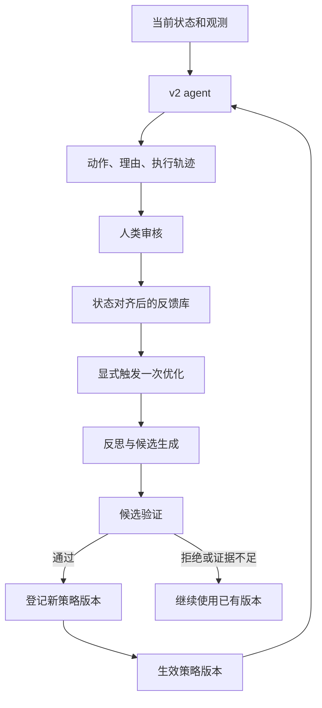

# 人类反馈驱动的 Spike Curation Agent：设计方案

2026-10-29 harness 优化方向补充：用户要求在完整 dataset 运行结束后，让优化 agent 根据代码、结果和 trace 自主修改 harness，不预先限制为几个局部模块或可调参数。采用 Meta-Harness 式自主编程与独立完整评估作为主要设计参考；详见 [自主 Harness 优化方案](docs/自主Harness优化_设计方案_20261029.md)。用户同时确认补跑“原 skill＋原 harness”的自主运行对照。此处记录设计方向，不表示代码优化已实现。

2026-10-29 实验安排补充：用户表示严格重放 baseline 已在运行，后续按“CH3/CH31 判断层学习 → CH20/CH30 重放评估 → 冻结 skill 自主运行 → 根据完整开发轨迹优化 controller → 自主运行对照评估”推进。具体数据边界、对照与指标见 [分阶段实验方案](docs/分阶段实验方案_重放学习与自主运行_20261029.md)。下述 2026-10-28 实施状态为历史快照；新增方案不表示 controller 优化已实现。

日期：2026-10-28  
状态：用户已确定 ACE＋GEPA 与可配置反馈频率 N，并授权实施；本地版本已完成真实 GEPA 引擎的离线集成验证。真实反馈效果和远程运行仍待验证。本文其余研究里程碑不表示全部完成。  
工作目录：`/Users/lzx/Tianmin/spike-sorting-agent-tianmin`  
分支：`tianmin/agent-changes`  
创建起点：Tengyang 仓库提交 `a0c5cdece0fa3fa3d162ba5e4bf3e9eb0cf4e415`。  
当前工作底座（用户于 2026-10-28 确认并已同步）：上游 `harness-v2` 分支，提交 `cb2a921f2e96f14742fda3ffb4a0662e4ee637fd`。版本变化见 [新版对比](docs/Tengyang_harness_v2_对比_20261028.md)。

实施进度：已完成状态绑定反馈、持久计数/去重/修订、ACE 式多图反思与增量建议整理、冻结建议、官方 GEPA 0.1.4 候选搜索与配对验收、整轮结束后 skill 加载、失败/中断恢复，以及托管 API provider。ACE 部分为领域适配的内部实现，不声称原库复现。使用命令、产物和实验参数见 [实现说明](docs/HUMAN_FEEDBACK_OPTIMIZATION.md)。61 项相关离线测试通过，完整合成 demo 见 `output/ace_gepa_offline_demo_20261028_01/DEMO_RESULT.json`。未启动真实付费调用、未同步 RunPod；workflow 搜索尚未实现。

## 1. 目标与当前优先级

Tianmin 希望在 Tengyang 当前 agent 的基础上，构建能够根据人类反馈自动改进后续行为的 agent。第一阶段的目标是打通：

**agent 执行 → 人类审核 → 反馈与轨迹对齐 → 生成优化候选 → 验证 → 接受或拒绝 → agent 使用新版本。**

用户最初要求先结合框架、频率后置，随后明确了第一条设计：**累计 N 条有效人类反馈触发一次判断层优化，N 可配置；第二条设计是 ACE 经验整理＋GEPA 候选搜索。**

- 支持显式触发以及 N 条反馈触发；N=1 为逐条模式，正整数为分批，manual 为手动。优化频率与搜索预算分开。
- 同一控制器轮次使用同一 skill，达到阈值后在轮次边界处理；末尾不足 N 条可显式 flush。
- 本阶段提供实验入口，不预先决定最优频率，也不承诺实时延迟。
- 用户进一步明确：**普通反馈优化不改 harness workflow；只有完整执行完一个 dataset 后，才汇总整条轨迹分析 workflow 优化。** 判断层与 workflow 的更新分别管理，不在同一个局部反馈更新中混合修改。
- 用户后续已授权开始本地代码实施；付费 API 和真实实验按具体运行范围另外安排。

后续频率切换可以复用同一优化循环，但严格在线模式还涉及反馈延迟、状态变化、版本切换和控制器恢复，不能把这些全部视为更改一个批大小参数。

## 2. 第一阶段的优化边界

### 2.1 执行框架与模型

- 执行框架：Tengyang `harness-v2` 的 `RoundsController`，同轮冻结状态、集中判断后执行；旧交错式 `CurationControllerV2` 保留作对照，不再作为当前默认底座。
- 执行模型：拟接入 Qwen3.5-27B 和 Gemma 4 31B 的托管 API。
- Gemma 的准确型号为 `google/gemma-4-31b-it`，与上游自部署计划中的 Gemma-4-E4B-it 不同；实验中分别标明。
- 模型权重固定，第一阶段不做 SFT/RL。
- 反思和候选生成模型是独立配置项，具体选择待定；比较实验中固定其配置，计入优化成本。

### 2.2 允许更新与固定项

| 项目 | 第一阶段安排 |
|---|---|
| 可学习的判断指导语 | 允许局部修改，作为版本化的学习层 |
| 经验 playbook | 允许增加、修改、合并、停用条目 |
| 条目的适用条件、反例、来源 | 随候选版本更新 |
| 经验选择策略 | 先采用固定、可解释策略和固定上下文预算，不同时搜索检索算法 |
| 动作集合、参数语义、输出 schema | 固定 |
| controller 的调度策略 / workflow | 单个 dataset 运行期间固定；完整 dataset 执行结束后才分析和提出候选改动，具体方法与开放范围待定 |
| 确定性的动作执行与状态校验 | 保留明确契约，不作为任意搜索目标 |
| 观测图与数值定义 | 固定；缺失证据登记为后续需求 |
| 原始 MAT、专家标注、评分器和数据划分 | 固定 |
| 模型、供应商、推理参数 | 每个实验条件内固定并记录 |

冻结的任务说明与动作契约、可学习的指导语、可检索经验应分层组织。优化器不能通过改写评分或放宽动作接口来提高表面分数。

### 2.3 两个层次的优化及生效边界

用户于 2026-10-28 确定以下安排：

| 层次 | 输入与可更新对象 | 时机与生效范围 |
|---|---|---|
| 判断层反馈优化 | 具体状态上的人类动作与理由；更新 skill、经验或指导语 | 每累计 N 条有效反馈触发；整轮结束后加载，不修改 workflow；N 可配置 |
| dataset 完成后的 workflow 优化 | 完整轨迹、反馈、漏问/冲突/重复处理记录、结果与成本；分析选簇、配对、复核与停止策略 | 完整执行结束后才开展分析；候选需独立验证，通过后在下一个 dataset 或另一次显式重跑中使用 |

一次运行固定 workflow 版本，判断策略另记版本；dataset 内任何判断层更新均不能悄悄更换调度规则。正在进行的 dataset 不因产生 workflow 建议而中途切换控制流。

完整轨迹允许定位控制流问题，但不保证仅凭终态分数就能推断正确修改；仍须通过回放或独立重跑验证。分析使用已授权的开发/适应 dataset；最终评估数据和结果不反向进入优化器。达到限制或异常停止的轨迹保留作诊断，不直接算作满足“完整 dataset 执行结束”的 workflow 更新触发条件。

当前只确定上述层次与边界，不代表已经选定 workflow 优化算法或授权实现。

## 3. 参考方法与采用方式

Tianmin 提供的四种方法代表不同优化对象，不能直接与三种更新频率一一对应。

| 方法 | 核心机制 | 本项目安排 |
|---|---|---|
| [GEPA](https://github.com/gepa-ai/gepa) | 从轨迹与反馈反思、变异候选，保留在不同任务子集上有优势的候选 | 借鉴候选生成、验证和保留机制，优化指导语与经验组合 |
| [ACE](https://github.com/ace-agent/ace) | Generator、Reflector、Curator 通过增量修改积累和整理 playbook | 借鉴反馈转经验、局部更新、去重与反例管理 |
| [AFlow](https://github.com/FoundationAgents/AFlow) | 在代码表示的工作流空间中通过树搜索探索流程 | 后续研究复核步骤、判断顺序等流程变化 |
| [Meta-Harness](https://github.com/stanford-iris-lab/meta-harness) | 利用历史代码、分数和轨迹搜索模型外围代码 | 后续研究经验检索、上下文构造与证据组织 |

用户已选择 **ACE 式经验整理 + GEPA 搜索**：先由反思/整理模块提炼带来源、条件和例外的增量建议，冻结后交给 GEPA 搜索选择与表述，最终产出一份版本化 skill。实现采用内部 ACE 领域适配与官方 `gepa==0.1.4` adapter；没有接入 AFlow/Meta-Harness。Controller 优化另行研究，现有动作序列只能提供部分示范，尚无完整调度监督。

GEPA 的 Pareto 思路包含保留在不同样本上有优势的候选，不应简单等同于“准确率与成本的二维排序”。第一版可保留多个有价值候选，但运行时仍通过明确规则选择一个生效版本。

## 4. 与现有代码的结合位置

以下是当前代码已具备的基础，不等同于优化闭环已经完成。

| 已有模块 | 路径 | 拟增加的连接 |
|---|---|---|
| 轮次同步调度器 | `src/pipeline/curation_controller_v2.py` 的 `RoundsController` | 记录策略版本；未来是否开放调度策略另定，保留固定基线 |
| 模型决策器 | `src/agent/curation_decider_v2.py` 的 `SkillDecider` | 复用 contract + skill 文件与版本哈希，在请求构造时加载指定版本 |
| 观测生成 | `src/agent/curation_observation_v2.py` | 复用图像和指标；可拆单簇 5 图、叶子单簇 4 图、簇对 3 图，输出包含结构化观察 |
| 本地单通道运行器 | `scripts/run/run_local_rollout.py` | 复用现有入口，补托管 API、反馈评估和需要的运行管理；首轮无续跑 |
| 本地 vLLM provider | `src/agent/vllm_provider.py` | 作为已有接口参考；托管 API 需独立适配认证、参数、费用和响应 |
| 执行器 | `src/cluster/manager.py` | 复用拆分、合并、删除及状态操作 |
| 人类反馈后端 | `mockups/curation-review/backend/server.py` | 导出、规范化真实审核记录并关联轨迹 |
| 工作副本与状态包 | `mockups/curation-review/backend/working_data.py` | 检查状态哈希及成员对应关系 |
| 一对一评分 | `scripts/analysis/curation_one_to_one.py` | 独立评价闭环结果，保持评分定义 |

当前决策器在初始化时加载提示词，不能假设写入新文件后正在运行的对象会自动更新。版本加载必须成为显式接口。

新版已有 vLLM 单通道运行器与 smoke 脚本，本地扩展已增加托管 API 入口，实际供应商兼容性待验证。学习 session 支持结果恢复，但 controller 整体续跑仍未支持：pending/fresh、已 KEEP 集合、已询问配对、拆分/合并否决记录、是否完成 final sweep 等不能仅靠学习 session 恢复。

上游附带未验证的 seed skill（10 条单簇、7 条簇对规则），包含开发数据专家理由与领域经验；固定与更新条件应从相同种子出发，不称作无专家知识的 minimal zero-shot。上游的反馈导入与 optimizer 尚未实现。部署文档记录 Gemma E4B 已通过 GPU smoke，本地未独立复测；这不代表我们选择的 Gemma31B 托管 API 已验证。

旧 RAG 模块和历史脚本仅作为参考，不默认直接插入 v2；需核对字段、数据来源和标签可见性。

## 5. 统一优化闭环



一次优化包含以下步骤：

1. 冻结输入：父策略版本、选定反馈 ID/修订版、数据范围、验证集和预算。
2. 校验反馈对应的状态、动作对象及观测，排除错配和重复消费。
3. 汇集相关轨迹，分析错误与成功案例；长轨迹保留全文，反思时选取可追溯片段。
4. 提出有限个经验或指导语修改候选，给出来源、预期修正行为和潜在副作用。
5. 对新反馈案例进行局部检查，对独立选择案例与历史回归案例进行验证。
6. 根据预先冻结的接受规则接受、拒绝或暂存候选；没有合格候选是合法结果。
7. 保存新版本及验证证据，后续运行显式加载新版本。

第一阶段先在一次运行或明确暂停点之外触发判断层优化，在下一次运行使用新版本，暂不在正在处理的决策请求中热更新。workflow 优化是独立的 dataset 结束后步骤，不纳入这里的一次局部反馈更新；实现 dataset 内的判断层更新时，也必须继续遵守 workflow 全程固定的边界。

## 6. 数据契约

### 6.1 TraceRecord：发生了什么

至少记录：

- `run_id`、`decision_id`、完整 dataset ID、数据哈希；
- 操作前后状态哈希，source/target 及成员身份；
- 观测和图像哈希、请求内容、模型返回动作与简短理由；
- 执行动作及结果、错误和停止原因；
- controller、模型、供应商、prompt、playbook 和检索结果的版本；
- token、费用、耗时。

“完整轨迹”指可观察的输入、输出和工具执行记录，不以能够取得模型隐藏思维链为前提。

### 6.2 FeedbackRecord：人类纠正了什么

优先复用现有审核字段：

- 对应的 `decision_id`、状态和图像哈希；
- agent 原动作、目标和理由；
- 专家认可/不认可、纠正动作、纠正目标；
- 专家理由、正面评论、置信度和证据是否充分；
- 专家额外查看的图、指标和对象；
- 审核者、时间、修订号、反馈来源与参考答案曝光情况。

缺少可靠状态映射的历史反馈先进入待核对区，不直接用于自动更新。反馈修订后，能追溯依赖旧版反馈的经验和策略；修订不简单追加为第二条独立监督。

### 6.3 ExperienceEntry：学到了什么

每条经验包含：建议、适用条件、反例/例外、支持反馈 ID、冲突来源、状态及版本。经验状态可以是候选、生效、争议、停用。

例如，专家指出一次合并仅依据平均波形相似、忽略其他现有证据。优化器应提炼带适用条件的比较规则，并在其他案例上验证；不能记录“CH30 的 cluster X 不要与 Y 合并”作为通用规则。

有益/有害计数用于管理经验，但不自动视为该经验产生因果收益的证明。

### 6.4 CandidateVersion：究竟改了什么

记录父版本、指导语与经验快照、差异、使用的反馈范围、生成器设置、验证结果、接受理由和成本。候选生成后保持不可变，生效指针可回滚到已验证版本。

## 7. 反馈处理原则

1. **动作纠正与策略学习分开。** 专家纠正当前分群不等于 agent 已学会；两者各自记录操作与效果。
2. **反馈绑定状态，而不是仅绑定 cluster 编号。** 分裂和合并后同名 cluster 的成员可能变化。
3. **区分判断错误和证据不足。** 专家使用了模型不可见的 PCA 等证据时，登记观测缺口，不能靠生成规则假装解决。
4. **不同意不自动产生正确答案。** 缺少纠正动作或解释的记录只提供弱信号。
5. **保留专家分歧。** 不以最后一条反馈自动覆盖此前意见；争议条目暂不变成全局强规则。
6. **支持正面反馈。** 保留成功策略，避免优化器只看失败而破坏原能力。
7. **处理动作接口之外的反馈。** 例如专家指定了当前 controller 不会提供的比较对象，登记为能力缺口，不能强行改成接口内的标签。
8. **限制答案泄漏。** 未来评估样本的专家答案不进入当前请求、经验库或优化器；用于学习的过去反馈可以形成经验，但不能在同一已曝光样本上证明泛化。

## 8. 验证与接受机制

### 8.1 三类检查

| 检查 | 目的 | 能证明的范围 |
|---|---|---|
| 接口与内容检查 | 合法动作、输出 schema、上下文预算、无样本 ID 专属规则 | 工程契约仍成立 |
| 新反馈案例与历史回归回放 | 修正反馈指出的问题，同时避免破坏已有案例 | 局部适应与已知回归表现 |
| 独立选择案例及预定闭环评估 | 检查新状态上的判断和最终分群 | 对所用评估范围的效果证据 |

生成候选使用的反馈案例与候选选择案例分开。固定选择集会随搜索次数积累选择偏差，因此还需最终不参与优化的评估范围。

第一版以反馈动作匹配、目标匹配、严重错误和回归约束为候选选择依据。接受阈值、允许的退化幅度、候选数和验证预算须在实验前确定；信息不足时暂存候选，不能默认上线。不以优化器自评或语言理由“听起来合理”作为成功标准。

### 8.2 闭环结果

沿用现有一对一匹配评分，同时报告：P/R/F1、匹配专家 unit 数、误删专家 spike、保留参考噪声、完成率、调用/token/费用/耗时，以及人工纠正次数。

终态 F1 默认用于独立效果验证。后续如让优化器直接使用开发集终态评分，应作为单独的优化条件记录；最终评估答案始终隔离。一个终态分数不能唯一确定哪一步判断错误。

未完成轨迹单列完成率和停止原因，不补记为完整终态分数，也不能只报告成功运行而隐藏失败。

## 9. 数据与实验设计

### 9.1 最小对照

- 固定 agent：不使用反馈学习。
- 只纠正操作：允许专家修正当前状态，但不更新指导语和经验。
- 反馈检索：保存并检索历史案例，不自动提炼规则。
- 反馈优化：采用本文的候选生成、验证和版本更新循环。

先用一个执行模型打通流程，再在另一个模型上复测。两个模型独立维护策略和反馈消费记录；跨模型迁移另设实验条件。

### 9.2 两种评估环境

**固定反馈流回放：** 同一输入与反馈流，先预测、再揭示反馈、再学习，测后续未揭示案例。适合验证学习机制及后续频率比较。

**真实闭环：** agent 的动作改变分群，专家审核实际状态。轨迹分叉后，不能把专家历史第 N 步答案当作 agent 第 N 步答案；需要精确状态匹配或新的人工审核。

人工直接纠正带来的终态收益与策略更新带来的后续收益分别报告。

### 9.3 四通道的边界

四个主通道是 CH31、CH3、CH20、CH30。CH3 和 CH31 共享 `cM2-e004_004-006` 路径录音块，整体形成三个路径推定的录音块；不随机按单步样本拆分相关状态。

可按三个录音块轮换学习、选择和评估角色，每轮重置经验与优化历史。这只是规模很小的开发性分组评估，且四通道已有历史开发曝光，不能声称 pristine held-out 泛化。严格泛化需要新增未参与设计的录音。

历史专家编辑日志缺少 KEEP/NOT_MERGE，需通过新审核补充，避免验证集只衡量改变状态的动作。

## 10. 模块与接口草案

以下是逻辑职责，不是已经创建的代码结构：

| 模块 | 职责 |
|---|---|
| AgentRunner | 配置模型、数据、v2、轨迹与结果，显式加载策略版本 |
| FeedbackAdapter | 接收审核导出，规范化反馈并校验状态、修订和来源 |
| FeedbackStore | 保存不可变历史与有效修订，记录反馈消费范围 |
| PolicyStore | 保存指导语、经验和生效版本 |
| Reflector / Proposer | 结合反馈与轨迹生成有界候选修改 |
| CandidateEvaluator | 在冻结输入上比较候选与父版本，记录回归和成本 |
| VersionRegistry | 接受、拒绝、暂存与回滚版本 |
| OptimizationCoordinator | 串联一次完整优化，提供未来触发器的入口 |

核心接口概念：

```text
run_agent(dataset, model_profile, policy_version, run_config) -> RunRecord
ingest_feedback(review_export, trace_index) -> ValidatedFeedback
optimize_once(base_version, feedback_ids, validation_spec, budget) -> OptimizationResult
activate_version(candidate_version, acceptance_record) -> ActiveVersion
```

`optimize_once` 不自行决定什么时候触发，不读取未来反馈；返回 accepted / rejected / deferred / failed 等明确状态。只有通过接受规则的候选可生效。重复执行和中断恢复必须能够识别已有产物，避免重复付费或重复应用更新。

第一版允许通过现有审核导出或结构化文件接入反馈，不把完整网页实时集成作为打通循环的前置条件。

## 11. 实施里程碑与验收

### M0：建立可运行、可追溯的基线

在新版现有单通道运行器上接托管 API provider，核对四通道参数化运行、数据 manifest、环境和预算记录。先验证可拆单簇 5 图、叶子单簇 4 图、成对 3 图及 observe-then-act 输出 schema，再做小范围真实运行。开发与验证使用独立副本，数据与历史输出不覆盖。

验收：一次 v2 运行能记录完整版本、状态和输出；接口失败明确停止且可诊断。

### M1：反馈与轨迹连接

接入真实审核导出，验证 source/target、状态和修订，建立经验与反馈来源关系。

验收：能准确定位“哪条反馈针对哪个版本、哪个状态、哪次判断”；错配与未解决分歧不会悄悄进入优化。

### M2：一次完整优化闭环

显式选择一组反馈，生成候选，完成验证，登记接受或拒绝结果；下一次运行加载已接受策略。

验收：候选变化可审计；存在拒绝路径；版本可回滚；模型请求确实包含所选版本的学习内容。工程打通不以必须出现分数提升为条件。

### M3：学习效果验证

对固定 agent、直接纠正、反馈检索与反馈优化进行有预算的小规模对照，再检查完整闭环结果。

验收：区分记住旧案例、人工纠正和后续策略提升；同时报告失败、回归、费用和评估局限。

### 后续阶段

- 根据需求加入逐条、分批、全量触发器和相应评测。
- 如需要同一轨迹内更新，补齐暂停、恢复和决策边界版本切换。
- 完整执行一个 dataset 后，再在独立步骤中研究 workflow 优化，可评估 AFlow / Meta-Harness 等方法；经验证后仅在后续运行生效。

## 12. 可配置的反馈触发频率

用户已确定并实现统一入口；频率比较由后续实验设计决定：

| 模式 | 将来的触发条件 |
|---|---|
| 每次反馈 | 每条有效反馈触发一次候选更新与验证；触发不保证产生新生效版本 |
| 部分数据 | 预先约定的反馈批次或数据子集完成后触发 |
| 全部数据 | 收齐约定优化集的反馈和结果后触发；最终测试数据不属于优化集 |

三种模式共用同一 ACE＋GEPA 优化流程，由持久化 session 负责触发。后续比较需同时考虑反馈量、优化预算、顺序和延迟。Workflow 优化另设 dataset 完成后的入口，不随局部反馈频率变化而在 dataset 内触发。

## 13. 实施前待确定项

- 反馈来源：先用已有真实审核导出，还是先收集一批针对 v2 的新反馈；实际可用数量尚未核验。
- 执行 API 的供应商、精度、thinking 与结构化输出兼容性；历史调用成功不代表新版协议已验证。
- 反思/生成模型的具体配置；方法已确定为 ACE 内部适配＋官方 GEPA 搜索。
- dataset 完成后的 controller/workflow 优化采用何种方法、开放哪些接口，以及使用部分专家轨迹示范、补收调度反馈还是开发集结果搜索；运行期间不改 workflow 的边界已确定。
- 每轮候选数、上下文预算、接受阈值、模型调用预算。
- 四份 MAT 和 manifest 在独立副本中的合规接入路径、版本和环境依赖。
- 验证案例划分、专家分歧处理及所需补充标注。

这些项目影响真实实验配置；代码已提供反馈频率入口，尚未确定实验分组与最优频率。

## 14. 参考与设计来源

- Tianmin 提供的方向：GEPA、ACE、AFlow、Meta-Harness；用户要求基于 Tengyang agent 学习人类反馈。
- [GEPA repository](https://github.com/gepa-ai/gepa) 与 [论文](https://arxiv.org/abs/2507.19457)：反思与候选搜索。
- [ACE repository](https://github.com/ace-agent/ace)：增量经验整理。
- [AFlow repository](https://github.com/FoundationAgents/AFlow)：工作流搜索。
- [Meta-Harness repository](https://github.com/stanford-iris-lab/meta-harness) 与 [论文](https://arxiv.org/abs/2603.28052)：外围代码优化。
- 上述仓库说明已于 2026-10-28 查阅；本文不将其其他任务上的收益当作 spike curation 的预期收益。
- 本仓库现状与历史协议见 [项目总文档](项目总文档.md)。本文描述独立副本拟开展的工作，不将设计项写成上游已完成能力。
